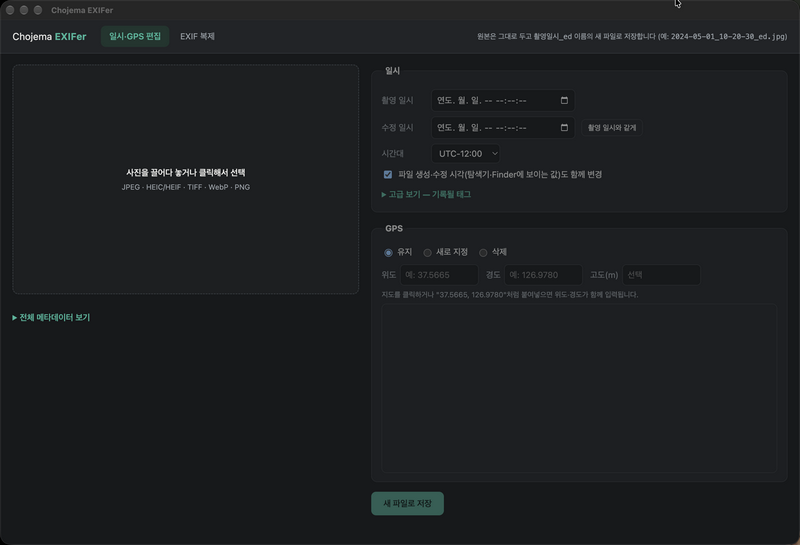
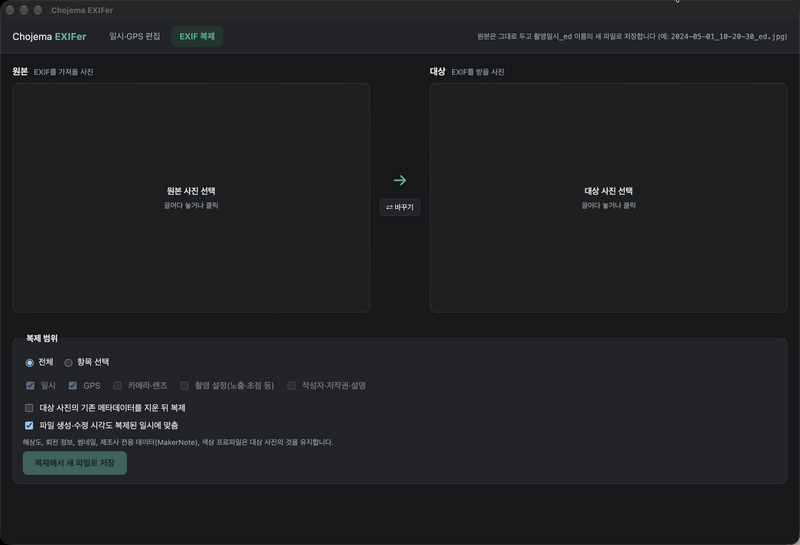

# Chojema EXIFer

**한국어** | [English](#english)

사진의 촬영·수정 일시와 GPS를 수정하고, 한 사진의 EXIF를 다른 사진으로 복제하는 Windows·macOS 데스크톱 앱입니다.
원본은 건드리지 않고 항상 촬영 일시를 이름으로 한 새 파일 `YYYY-MM-DD_HH-MM-SS_ed.<확장자>`로 저장합니다.
PNG는 EXIF를 읽지 못하는 앱이 많아 JPG로 변환해 저장합니다.

- 작성자: Chulwoo Park (2026)
- 라이선스: MIT — [LICENSE](LICENSE) 참고
- 현재 버전: 0.10.0 — 변경 내역은 [RELEASE_NOTES.md](RELEASE_NOTES.md) 참고
- 내려받기: [Releases](https://github.com/chojema/chojema-exifer/releases) 페이지

- 지원 형식: JPEG, HEIC/HEIF, TIFF, WebP, PNG (RAW·GIF·BMP·동영상 제외)
- 구성: Electron + ExifTool(`exiftool-vendored.pl` / `exiftool-vendored.exe`로 동봉)

## 화면 (macOS)

**일시·GPS 편집** — 촬영·수정 일시와 시간대를 입력하고, 지도나 좌표로 GPS를 지정합니다.



**EXIF 복제** — 왼쪽 원본 사진의 EXIF를 오른쪽 대상 사진에 전체 또는 항목별로 복제합니다.



## 개발

```sh
npm install
npm start                          # 앱 실행
npm test -- <샘플 사진 폴더>        # sample.jpg/png/tiff/heic/webp 등으로 통합 테스트
npm run dist                       # macOS + Windows 설치 파일 모두
npm run dist:mac                   # dist/*.dmg (arm64, x64)
npm run dist:win                   # dist/Chojema EXIFer Setup <버전>.exe
npm run clean:dist                 # dist 정리만 따로 실행
npm run make:icons                 # build/icon.svg → icon.png, icon.icns, icon.ico 재생성
```

### 빌드 후 정리 규칙

빌드가 끝나면 `scripts/clean-dist.js`가 자동으로 실행되어 `dist/`에 **설치 파일만** 남깁니다.

- 남김: `*.dmg`, `* Setup *.exe` — 배포용이며, 이전 버전 설치 파일도 기록으로 유지
- 삭제: 압축 해제된 앱 폴더(`mac/`, `mac-arm64/`, `win-unpacked/` 등), `*.blockmap`, `latest*.yml`
  (자동 업데이트용, 이 앱은 미사용), `builder-debug.yml` — 모두 다음 빌드에서 다시 생성됨
- 규칙에 없는 파일은 지우지 않고 그대로 두며 출력에 표시
- 새 빌드 산출물 종류가 생기면, 기록·재사용 가치가 없는 경우 `REMOVE_FILES`에 추가

Windows 빌드는 macOS에서도 만들 수 있지만, `exiftool-vendored.exe`가 설치되어 있어야 합니다
(`package.json` 의존성에 포함, 다른 OS에서는 `npm install --force`).

## 구조

- `src/main/exiftool.js` — ExifTool 실행 (UTF-8 인자 파일 사용)
- `src/main/metadata.js` — 읽기, 일시 태그 계획(`planDates`), 저장(`saveEdits`), EXIF 복제(`copyExif`)
- `src/main/preview.js` — HEIC/TIFF 미리보기 변환
- `src/renderer/` — 화면 (일시·GPS 편집, EXIF 복제 탭)

## 동작 메모

- 촬영 일시 → EXIF DateTimeOriginal/CreateDate/OffsetTime*, XMP(exif·xmp·photoshop), IPTC(JPEG·TIFF), PNG CreationTime, GPS 날짜·시각(UTC), 파일 생성 시각
- 수정 일시 → EXIF ModifyDate/OffsetTime, XMP ModifyDate/MetadataDate, PNG ModifyDate, 파일 수정 시각
- 파일 생성 시각: macOS는 `utimes`(과거 시각 지정 시 생성 시각도 이동), Windows는 ExifTool `FileCreateDate`
- 저장 파일 이름: 저장된 파일의 촬영 일시(입력한 값) → `2024-05-01_10-20-30_ed.jpg`. 같은 이름이 있으면 ` (2)`처럼 번호를 붙임. 촬영 일시가 없으면 원본의 파일 수정 시각을 씀
- PNG → JPG 변환: `pngjs`로 읽고 `jpeg-js`로 품질 92 인코딩, 투명 부분은 흰색. EXIF·XMP·ICC 프로파일을 옮기고, PNG `CreationTime`만 있으면 `DateTimeOriginal`로 옮김
- EXIF 복제 시 제외: 해상도·크기, 회전, 썸네일·미리보기, MakerNote, ICC 프로파일, xmpMM, Photoshop IRB
- 지도: OpenStreetMap 타일 (인터넷 연결 필요)

---

## English

[한국어](#chojema-exifer) | **English**

A Windows and macOS desktop app that edits the date/time and GPS of photos, and copies EXIF from one photo to another.
Originals are never modified; results are always saved as a new file named after the date taken, `YYYY-MM-DD_HH-MM-SS_ed.<ext>`.
PNG files are converted to JPG when saved, because many apps do not read EXIF in PNG.

- Author: Chulwoo Park (2026)
- License: MIT — see [LICENSE](LICENSE)
- Current version: 0.10.0 — see [RELEASE_NOTES.md](RELEASE_NOTES.md) for changes
- Download: [Releases](https://github.com/chojema/chojema-exifer/releases) page

- Supported formats: JPEG, HEIC/HEIF, TIFF, WebP, PNG (RAW, GIF, BMP, and video are not supported)
- Built with: Electron + ExifTool (bundled via `exiftool-vendored.pl` / `exiftool-vendored.exe`)

### Screenshots (macOS)

**Date/GPS editing** — enter the date taken, date modified and time zone, and set GPS on the map or by coordinates. (The UI is in Korean.)


**EXIF copy** — copy the EXIF of the source photo on the left to the target photo on the right, in full or by group.


### Development

```sh
npm install
npm start                          # run the app
npm test -- <sample photo folder>  # integration test with sample.jpg/png/tiff/heic/webp, etc.
npm run dist                       # both macOS and Windows installers
npm run dist:mac                   # dist/*.dmg (arm64, x64)
npm run dist:win                   # dist/Chojema EXIFer Setup <version>.exe
npm run clean:dist                 # run the dist cleanup on its own
npm run make:icons                 # regenerate icon.png, icon.icns, icon.ico from build/icon.svg
```

#### Post-build cleanup

After a build, `scripts/clean-dist.js` runs automatically and leaves **only installers** in `dist/`.

- Kept: `*.dmg`, `* Setup *.exe` — for distribution; installers of earlier versions are kept as a record
- Removed: unpacked app folders (`mac/`, `mac-arm64/`, `win-unpacked/`, etc.), `*.blockmap`, `latest*.yml`
  (auto-update metadata, unused by this app), `builder-debug.yml` — all regenerated by the next build
- Files not covered by the rules are left in place and reported in the output
- When a new kind of build output appears and has no value for record or reuse, add it to `REMOVE_FILES`

The Windows build can also be made on macOS, but `exiftool-vendored.exe` must be installed
(it is in the `package.json` dependencies; on other OSes use `npm install --force`).

### Structure

- `src/main/exiftool.js` — runs ExifTool (via a UTF-8 argument file)
- `src/main/metadata.js` — reading, date tag planning (`planDates`), saving (`saveEdits`), EXIF copy (`copyExif`)
- `src/main/preview.js` — HEIC/TIFF preview conversion
- `src/renderer/` — UI (date/GPS edit tab, EXIF copy tab)

### Behavior notes

- Date taken → EXIF DateTimeOriginal/CreateDate/OffsetTime*, XMP (exif, xmp, photoshop), IPTC (JPEG, TIFF), PNG CreationTime, GPS date/time (UTC), file creation time
- Date modified → EXIF ModifyDate/OffsetTime, XMP ModifyDate/MetadataDate, PNG ModifyDate, file modification time
- File creation time: `utimes` on macOS (setting an earlier time also moves the creation time), ExifTool `FileCreateDate` on Windows
- Output file name: the saved file's date taken (the value you entered) → `2024-05-01_10-20-30_ed.jpg`. If the name exists, a number such as ` (2)` is added. Without a date taken, the original's file modification time is used
- PNG → JPG conversion: read with `pngjs`, encoded with `jpeg-js` at quality 92; transparent areas become white. EXIF, XMP and the ICC profile are carried over, and a PNG `CreationTime` alone becomes `DateTimeOriginal`
- Excluded from EXIF copy: resolution/dimensions, orientation, thumbnails/previews, MakerNote, ICC profile, xmpMM, Photoshop IRB
- Map: OpenStreetMap tiles (internet connection required)
